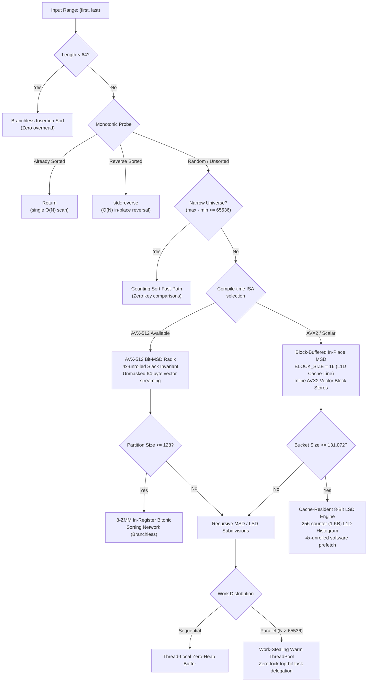

# KDR short

### Ultra-High-Performance Adaptive SIMD Radix Sorting Engine for Modern C++

[](https://isocpp.org/)
[](include/kdr/kdr_sort.hpp)
[](include/kdr/kdr_sort.hpp)
[-red.svg)](LICENSE)
[-success.svg)](include/kdr/kdr_sort.hpp)
[](include/kdr/kdr_sort.hpp)

**KDR short** is a header-only C++17 sorting engine engineered for extreme throughput on modern superscalar architectures. Combining **in-place Most Significant Digit (MSD) Radix partitioning**, **in-register SIMD Bitonic sorting networks**, and **cache-resident Least Significant Digit (LSD) kernels**, KDR short delivers very high sorting throughput for integer, floating-point, and string data across AVX-512, AVX2, and generic CPU platforms. It is the fastest of the libraries compared below on 8-/16-bit integers and on small-range data, and competitive with Google VQSort and Intel `x86-simd-sort` on 32-/64-bit keys (see the reproducible, verified benchmarks).

---

## Highlights

- 🚀 **8-/16-bit integers (counting-sort fast path):** 10M `uint8_t` in ~5 ms and 5M `uint16_t` in ~8 ms on a single thread - roughly **45-90× faster than `std::sort`**, and **2.4-5× faster than VQSort / `x86-simd-sort`** on 16-bit keys (neither supports 8-bit).
- ⚡ **Small-range / low-cardinality data:** 5M `uint32_t` in `[0..10k]` takes ~6 ms (AVX2 build) - **~50× faster than `std::sort`** and 1.5-5× faster than VQSort / `x86-simd-sort` (the gap is smaller in the AVX-512 build).
- 📈 **32-/64-bit uniform keys:** **~4-19× faster than `std::sort`**, but on one thread it is **on par with or somewhat slower than** `x86-simd-sort` and VQSort (about 1.1-1.8× their time). Multi-threading (`kdr::parallel_sort`) is where KDR short is designed to pull ahead; see the note below.
- 🔤 **Strings:** ~1.2× faster than `std::sort` on 1M synthetic URLs with long shared prefixes (single thread). Neither VQSort nor `x86-simd-sort` sorts strings.
- 🛡️ **Bounded scratch memory:** numeric sorts use a fixed per-thread scratch buffer (512 KB for 32-bit, 1 MB for 64-bit keys, allocated once) plus at most a 256 KB counting table for 16-bit keys. String sorting uses O(N) index buffers (~33 bytes per string).
- 💤 **Warm thread pool:** worker threads block on a `std::condition_variable` (0% CPU when idle).
- 🔌 **Header-only, C++17, no dependencies.** GCC, Clang and MSVC; AVX-512, AVX2 and portable scalar back-ends are selected at **compile time** from the compiler's target flags.

---

## Architectural Workflow

The following flowchart illustrates the adaptive multi-stage decision pipeline executed by KDR short upon receiving an input range:



---

## Performance Benchmarks

All numbers in this section were measured by running `benchmarks/bench_compare.cpp` (included in this repository) on a **single thread**.

- **Machine:** Intel Xeon (Sapphire Rapids class: AVX-512, AVX-512 FP16, VBMI2), 1 vCPU @ 2.1 GHz, Linux, GCC 13.3, `-O3 -std=c++17`.
- **AVX2 build:** `-march=haswell` &nbsp;|&nbsp; **AVX-512 build:** `-march=sapphirerapids`.
- **Libraries:** Google Highway (`hwy::VQSort`, current master, static dispatch), Intel `x86-simd-sort` (current master, static include), `std::sort`.
- **Method:** the input is copied before every run and only the sort is timed; the median of 3-9 runs is reported; every contender's output is verified against `std::sort`. This is a shared cloud VM, so expect roughly ±30% run-to-run noise (e.g. 5M `uint32_t` KDR measured 29 ms in one run and 41 ms in another).
- **Data:** uniform random full-range values unless noted. `float`/`double` are uniform in [-1e9, 1e9]. Strings are synthetic URLs (4 hosts, long shared prefixes), not real-world data.
- **Multi-threaded results are not part of this table.** The test machine has a single core, so `kdr::parallel_sort` could not be benchmarked. Highway VQSort and `x86-simd-sort` are single-threaded libraries; compare KDR's multi-threaded numbers against a parallel baseline (e.g. `std::sort` with `std::execution::par`, IPS4o), not against them.
- Lower is better, all times in ms. **Bold** = fastest in the row. `n/a` = not supported by that library.

### 1. AVX2 build (`-march=haswell`)

| Data type & distribution | N | `std::sort` | VQSort | x86-simd-sort | KDR short | KDR vs `std::sort` |
| :--- | ---: | ---: | ---: | ---: | ---: | ---: |
| `uint8_t` uniform | 10,000,000 | 427.35 | n/a | n/a | **4.84** | 88.4× |
| `int8_t` uniform | 10,000,000 | 411.03 | n/a | n/a | **5.75** | 71.5× |
| `uint16_t` uniform | 5,000,000 | 361.34 | 38.73 | n/a | **7.60** | 47.6× |
| `int16_t` uniform | 5,000,000 | 361.40 | 33.18 | n/a | **8.31** | 43.5× |
| `uint32_t` uniform | 5,000,000 | 456.86 | 86.61 | **32.04** | 46.33 | 9.9× |
| `uint32_t` small range [0..10k] | 5,000,000 | 303.79 | 30.28 | 20.15 | **5.98** | 50.8× |
| `uint32_t` pre-sorted | 5,000,000 | 71.83 | **1.48** | 32.38 | 6.68 | 10.7× |
| `int32_t` uniform | 1,000,000 | 83.07 | 14.48 | **6.04** | 7.96 | 10.4× |
| `uint64_t` uniform | 2,000,000 | 191.71 | 89.94 | **40.99** | 46.37 | 4.1× |
| `float` uniform | 2,000,000 | 193.62 | 29.36 | **11.94** | 20.01 | 9.7× |
| `double` uniform | 2,000,000 | 199.77 | 70.38 | **24.07** | 44.24 | 4.5× |
| `std::string` URLs | 1,000,000 | 554.42 | n/a | n/a | **452.26** | 1.2× |

### 2. AVX-512 build (`-march=sapphirerapids`)

| Data type & distribution | N | `std::sort` | VQSort | x86-simd-sort | KDR short | KDR vs `std::sort` |
| :--- | ---: | ---: | ---: | ---: | ---: | ---: |
| `uint8_t` uniform | 10,000,000 | 446.96 | n/a | n/a | **5.14** | 87.0× |
| `int8_t` uniform | 10,000,000 | 431.54 | n/a | n/a | **5.65** | 76.4× |
| `uint16_t` uniform | 5,000,000 | 360.95 | 31.17 | 19.14 | **7.79** | 46.4× |
| `int16_t` uniform | 5,000,000 | 363.84 | 29.82 | 18.24 | **8.20** | 44.4× |
| `uint32_t` uniform | 1,000,000 | 82.90 | 3.82 | **3.77** | 4.39 | 18.9× |
| `uint32_t` uniform | 5,000,000 | 454.60 | **20.83** | 21.31 | 29.38 | 15.5× |
| `uint32_t` uniform | 20,000,000 | 2067.14 | 145.81 | **112.54** | 148.84 | 13.9× |
| `uint32_t` small range [0..10k] | 5,000,000 | 305.29 | 17.02 | 20.73 | **11.07** | 27.6× |
| `uint32_t` pre-sorted | 5,000,000 | 73.01 | 24.19 | 22.96 | **4.27** | 17.1× |
| `int32_t` uniform | 1,000,000 | 84.01 | 3.79 | **3.73** | 4.62 | 18.2× |
| `uint64_t` uniform | 1,000,000 | 82.86 | **7.84** | 8.07 | 8.42 | 9.8× |
| `uint64_t` uniform | 2,000,000 | 174.77 | **17.39** | 17.70 | 19.45 | 9.0× |
| `uint64_t` uniform | 5,000,000 | 511.32 | 55.54 | **52.37** | 64.63 | 7.9× |
| `uint64_t` uniform | 20,000,000 | 2069.87 | 274.49 | **269.23** | 288.00 | 7.2× |
| `float` uniform | 2,000,000 | 215.25 | 8.05 | **7.86** | 14.44 | 14.9× |
| `double` uniform | 2,000,000 | 189.61 | 21.51 | **20.44** | 30.43 | 6.2× |
| `std::string` URLs | 1,000,000 | 577.63 | n/a | n/a | **485.85** | 1.2× |

### 3. How to read these results

- **8-/16-bit keys and small-range 32-bit data** are handled by counting sort (8-bit and 16-bit keys always; 32-bit keys when `max - min <= 65,536` and N >= 32,768; 64-bit keys never). KDR wins these rows because it does O(N) work; the comparison for 8-bit is against `std::sort` only, since no SIMD sort library supports 8-bit keys.
- **Wide-range 32-/64-bit uniform data** is where the SIMD-quicksort libraries are strongest. In these measurements, single-threaded KDR takes about 1.1-1.8× their time depending on type and ISA.
- **Pre-sorted input:** KDR detects sorted input with a linear scan (~4-7 ms for 5M elements). VQSort in the AVX2 build was faster here (1.48 ms) but not in the AVX-512 build (24 ms); this was not investigated further.

### 4. Reproduce

```bash
# 1. Build Highway's VQSort for the ISA you want to test (see benchmarks/build_compare.sh)
HWY=~/highway benchmarks/build_compare.sh hwy_avx2 haswell
# 2. Build and run the comparison
g++ -std=c++17 -O3 -march=haswell -Iinclude -I~/highway -I~/x86-simd-sort/src \
    benchmarks/bench_compare.cpp hwy_avx2/libhwy_sort.a -o bench_avx2 -pthread
./bench_avx2 0     # main table      (./bench_avx2 1 = strings)
```

### 5. Author-reported multi-threaded results (AMD Ryzen 5 5500, Windows, MSVC 2019 `/O2 /arch:AVX2`)

These were measured by the author on a different machine and have **not** been independently reproduced. KDR (MT) uses all 12 hardware threads, so it must not be compared against single-threaded libraries.

| Data type | N | `std::sort` | KDR short (1T) | KDR short (MT) |
| :--- | ---: | ---: | ---: | ---: |
| `uint32_t` uniform | 5,000,000 | 330.22 ms | 52.43 ms | 18.03 ms |
| `int32_t` uniform | 1,000,000 | 59.84 ms | 10.12 ms | 4.51 ms |
| `uint64_t` uniform | 2,000,000 | 126.37 ms | 31.67 ms | 11.44 ms |
| `float` uniform | 2,000,000 | 162.79 ms | 25.48 ms | 13.29 ms |
| `double` uniform | 2,000,000 | 168.12 ms | 38.56 ms | 23.50 ms |
| `std::string` URLs | 1,000,000 | 388.72 ms | 294.10 ms | 169.64 ms |

---

## Feature Comparison Matrix

| Feature / Capability | `std::sort` | `pdqsort` | Google `VQSort` | Intel `x86-simd-sort` | **KDR short** |
| :--- | :---: | :---: | :---: | :---: | :---: |
| **Sorting Paradigm** | Comparison | Hybrid Quicksort | SIMD Quicksort | SIMD Quicksort / Network | **Adaptive MSD/LSD Radix + SIMD** |
| **Auxiliary Memory** | $O(\log N)$ | $O(\log N)$ | $O(\log N)$ | $O(\log N)$ | **Fixed scratch for numeric types (≤ 1 MB/thread); $O(N)$ for strings** |
| **8-bit Integer Sorting** | ✅ | ✅ | ❌ | ❌ | **✅** |
| **16-bit Integer Sorting** | ✅ | ✅ | ✅ | ✅ *(AVX-512 only)* | **✅** |
| **String Sorting (`std::string`)** | ✅ | ✅ | ❌ | ❌ | **✅ (MSD radix, 64-bit key cache)** |
| **Pivot Degeneracy Risk** | ❌ *(Heuristics)* | ❌ *(Guarded)* | ❌ *(Sampling)* | ❌ *(Sampling)* | **Zero (Deterministic Radix)** |
| **Thread Pool Idle CPU** | N/A | N/A | N/A | N/A | **0% (Cond-var Parked)** |
| **Header-Only, Zero Deps** | ✅ | ✅ | ❌ *(Highway lib)* | ❌ *(Submodule build)* | **✅ (Single `.hpp`)** |
| **MSVC / Clang / GCC Support** | ✅ | ✅ | ⚠️ *(Complex)* | ⚠️ *(Compiler dependent)*| **✅ (Native C++17)** |

---

## Microarchitectural Innovations

### 1. The L1D Cache-Line Invariant (`BLOCK_SIZE = 16`)
Traditional block-buffered in-place MSD algorithms rely on large bucket buffers ($B = 64$ to $256$), which easily exceed L1 Data Cache capacity when fanning out into 256 radix buckets ($256 \times 256 \times 4\text{ B} = 256\text{ KB} \gg 32\text{ KB}$ L1D).  
KDR short enforces $B = 16$:
$$\text{L1D Footprint} = 256 \times 16 \times 4\text{ B} = 16\text{ KB} \le \text{32 KB L1D}$$
Each 16-element block precisely matches one 64-byte hardware cache line. Bucket fills write sequentially into warm L1 lines without evicting surrounding CPU state.

```text
+-------------------------------------------------------------------+
|               L1 Data Cache (32 KB Capacity)                      |
|  +-------------------------------------------------------------+  |
|  |  256 Radix Buckets x 16 elements x 4 bytes = 16 KB Footprint |  |
|  |  [Bucket 0: 64B] [Bucket 1: 64B] ... [Bucket 255: 64B]       |  |
|  +-------------------------------------------------------------+  |
|  [ Remaining 16 KB: Code, Stack, Vector Registers, Scratch ]      |
+-------------------------------------------------------------------+
```

### 2. AVX2 Vector Block Streaming (`store_block_fast`)
When flushing a completed 16-element buffer to the destination partition, calling standard `std::memcpy` introduces function call overhead, register spills, and branching. KDR short replaces all flush operations with unrolled 256-bit AVX2 intrinsic stores:
```cpp
// Direct 256-bit register stores: 16 x uint32_t = 2 x _mm256_storeu_si256
_mm256_storeu_si256(reinterpret_cast<__m256i*>(dst),     v0);
_mm256_storeu_si256(reinterpret_cast<__m256i*>(dst + 8), v1);
```
This avoids the call overhead of `std::memcpy` for these fixed-size block flushes.

### 3. Software Memory Prefetching
During Phase 1 bucket allocation and sequential stream consumption, KDR short issues asynchronous hardware prefetch instructions:
```cpp
_mm_prefetch(reinterpret_cast<const char*>(ptr + PREFETCH_DISTANCE), _MM_HINT_T0);
```
By loading subsequent cache lines into L1D while the CPU computes radix histograms, DRAM latency penalties are effectively masked.

### 4. Cache-Resident 3-Stage 8-Bit LSD Engine
For sub-partitions with $N \le 131{,}072$ elements, KDR short transitions into a high-speed branchless LSD engine. Each stage processes an 8-bit radix:
- **Histogram Size:** $256 \times 4\text{ B} = 1\text{ KB}$ (100% L1D resident).
- **Loop Unrolling:** 4-way unrolled counting and scatter passes maximize instruction-level parallelism (ILP) and pipeline saturation.

### 5. Bounded Scratch Footprint

Numeric sorts do not allocate memory proportional to the input. Each thread owns one fixed scratch buffer (`thread_local`, allocated on first use: 512 KB for 32-bit keys, 1 MB for 64-bit keys), and the 16-bit and small-range counting-sort paths use a counting table of at most 256 KB. String sorting is the exception: it keeps `O(N)` index buffers (about 33 bytes per string).

---

## Quick Start Guide

### 1. Installation

KDR short is a single-header library. Simply copy `include/kdr/kdr_sort.hpp` into your project's include directory:

```bash
git clone https://github.com/SHo-oTR/KDR_short.git
# Copy kdr_sort.hpp into your include path
cp KDR_short/include/kdr/kdr_sort.hpp /your/project/include/kdr/
```

### 2. Basic Usage

```cpp
#include <kdr/kdr_sort.hpp>
#include <vector>
#include <string>
#include <iostream>

int main() {
    // 1. Primitive integer sorting (bounded scratch memory)
    std::vector<uint32_t> data = {105, 42, 999999, 12, 0, 854};
    kdr::sort(data);

    // 2. Parallel multi-threaded sorting (Auto hardware concurrency)
    std::vector<uint64_t> large_dataset(10'000'000);
    // ... fill large_dataset ...
    kdr::parallel_sort(large_dataset);

    // 3. Raw pointer ranges
    float arr[] = {3.14f, 1.41f, 2.71f, 0.577f};
    kdr::sort(arr, arr + 4);

    // 4. Parallel string sorting
    std::vector<std::string> urls = {
        "https://example.com/api/v2/users",
        "https://example.com/api/v1/orders",
        "https://example.com/api/v2/auth"
    };
    kdr::parallel_sort(urls);

    // 5. Explicit thread count
    kdr::sort(large_dataset, 4); // Run using 4 threads
}
```

### 3. Compiler Flags for Peak Performance

- **GCC / Clang:**
  ```bash
  g++ -O3 -march=native -std=c++17 -pthread your_app.cpp -o your_app
  ```
- **MSVC (Visual Studio):**
  ```cmd
  cl /O2 /arch:AVX2 /std:c++17 your_app.cpp
  # Or with AVX-512 enabled:
  cl /O2 /arch:AVX512 /std:c++17 your_app.cpp
  ```

---

## License

This project is licensed under the
PolyForm Noncommercial License 1.0.0.

- Personal use is permitted.
- Noncommercial use is permitted.
- Modification and redistribution are permitted for noncommercial purposes.
- Commercial use is not permitted without separate authorization from the copyright owner.

For commercial licensing inquiries, please contact:

kadir.karahan2009@gmail.com

License: https://polyformproject.org/licenses/noncommercial/1.0.0

```text
Contact Information:
Author: Kadir Karahan
Email:  kadir.karahan2009@gmail.com
```
